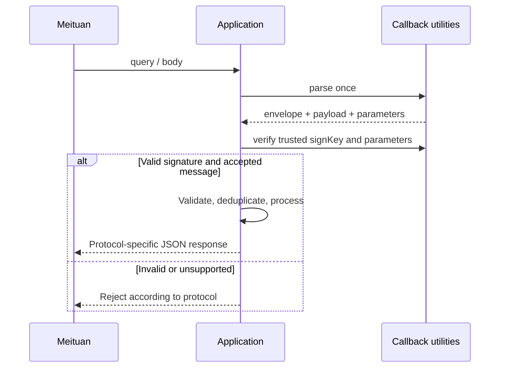

# meituan-sdk-extension

[English](./README.md) | [简体中文](./README.zh-CN.md)

[](https://github.com/easy-4-java/meituan-sdk-extension/actions/workflows/ci.yml) [](#compatibility) [](https://www.apache.org/licenses/LICENSE-2.0.txt)

A Java extension to the official Meituan `MtOpJavaSDK`, providing tenant-aware requests, business facades and callback models for server-side applications. It reuses official request types and works independently of Spring.

**Branch** `feature/2.0.x` · **Version** `2.0.x.20260630-SNAPSHOT` · **Official SDK** `1.0-20261112`

[Overview](#overview) · [Capabilities and architecture](#architecture) · [Versions and compatibility](#compatibility) · [Installation](#installation) · [Quick start](#quick-start) · [Configuration and tenant storage](#configuration) · [Business calls and platform APIs](#api) · [Callback parsing and responses](#callbacks) · [API inventories](#inventories) · [Build and verification](#verification) · [Troubleshooting, contributing and license](#support)

<a id="overview"></a>

## 1. Overview

Use this library when one application integrates multiple developer accounts, authorized stores or business lines. A call supplies `tenantId`; the executor selects that tenant's developer credentials and token, invokes Meituan and returns the official `MeituanResponse<T>`. Callback utilities expose a `MeituanCallbackMessage<T>`, separate signature verification and protocol response objects.

```text
Business request + tenantId
  → [Facade → tenant storage → executor → official client]
  → Meituan OpenAPI → official response / invocation exception

Meituan callback (query / body / Servlet request)
  → [CallbackUtil → payload model + original parameters]
  → Application verification, deduplication and business logic → ACK
```

The library handles invocation and protocol mapping. The application owns the HTTP endpoint, persistent configuration, token update scheduling, callback deduplication and transactions. Spring Boot applications can use the separate [meituan-spring-boot-starter](https://github.com/easy-4-java/meituan-spring-boot-starter); consult that repository for its versions and configuration.

<a id="architecture"></a>

## 2. Capabilities and architecture

| Capability | Implementation and boundary |
|---|---|
| Official SDK request coverage | 15 business facades cover 1,148 production `@ApiMeta` requests in the pinned SDK; official `corgiTest` requests are excluded |
| Tenant-aware calls | In-memory or custom storage, clients cached by developer credentials, token selected for each call |
| Platform APIs | OAuth exchange and refresh, unified authorization, per-call timeouts and `commonInvokeApi` |
| Callbacks | 282 registered `businessId + msgType` combinations across 27 businesses, automatic or explicit parsing, verification and synchronous responses |
| Verification | SDK coverage tests, enum/registry consistency tests, JUnit regression, JaCoCo and strict Javadoc checks |

This project builds one Maven JAR with the following packages.

| Package | Responsibility |
|---|---|
| [`config`](src/main/java/io/github/easy4j/meituan/config) | Shared client defaults and tenant credentials |
| [`client`](src/main/java/io/github/easy4j/meituan/client) | Official client factory and request executors |
| [`tenant`](src/main/java/io/github/easy4j/meituan/tenant) | Storage SPI, loader, in-memory/TTL cache and ThreadLocal context |
| [`service`](src/main/java/io/github/easy4j/meituan/service) | Business facades and separate MeituanPlatformService |
| [`callback`](src/main/java/io/github/easy4j/meituan/callback) | Parsing, verification, envelopes, responses and model index |
| [`callback/model`](src/main/java/io/github/easy4j/meituan/callback/model) | Business payloads grouped by `biz<businessId>` |
| [`callback/type`](src/main/java/io/github/easy4j/meituan/callback/type) | Single message definition source linking IDs, models and official documentation |
| [`exception`](src/main/java/io/github/easy4j/meituan/exception) | MeituanJavaException invocation errors |

<a id="compatibility"></a>

## 3. Versions and compatibility

Source targets and CI toolchains are listed separately. The current branch compiles for Java 17 and runs CI on JDK 17. Use the same JDK to reproduce the build.

| Branch | POM version | Compile target / CI JDK | JSON / Servlet | Maven Wrapper |
|---|---|---|---|---|
| `feature/1.0.x` | `1.0.x.20260730-SNAPSHOT` | 8 / 8 | Jackson 2.18.9 · `javax.servlet` | 3.9.16 |
| `feature/2.0.x` | `2.0.x.20260630-SNAPSHOT` | 17 / 17 | Jackson 2.22.1 · `jakarta.servlet` | 3.9.16 |
| `feature/3.0.x` | `3.0.x.20260730-SNAPSHOT` | 17 / 21 | Jackson 3.2.4 · `jakarta.servlet` | 4.0.0-rc-5 |

Values come from each branch’s `pom.xml` and CI configuration. The current `2.0.x` line uses Jackson 2 APIs under `com.fasterxml.jackson.*`. Servlet API is `provided`; applications using the Servlet entry point supply Jakarta Servlet 6.

The `2.0.x` build verifies the original official SDK, transforms its Validation references to Jakarta and embeds it in the extension JAR. The `1.0.x` and `3.0.x` lines depend directly on the official SDK, whose internals still include `javax.validation` dependencies. Check the host dependency tree when selecting a line. Cross-line upgrades require Jackson/Servlet import changes; legacy callback packages must also move to `callback.model.biz<businessId>`.


### 3.1 Jakarta Validation adaptation

This line embeds the transformed official SDK classes in the extension JAR and uses Jakarta Validation 3.0.2, Hibernate Validator 8.0.4.Final and Expressly 5.0.0. Consumers only need the extension dependency. Do not add the raw `MtOpJavaSDK` or legacy javax Validation / Hibernate Validator 6, which would introduce duplicate classes and mixed validation stacks.

The pinned input is `com.sankuai.sjst:MtOpJavaSDK:1.0-20261112`, SHA-256 `144ed5569a112b1c27de3b9b3d5a237781c593823a73268623832fb28863250c`. Builds reject mismatched input and record provenance in `META-INF/easy4j/meituan-sdk-origin.properties`. Only the `javax.validation` namespace is transformed; official classes and signature bytecode are preserved.

<a id="installation"></a>

## 4. Installation

### 4.1 Maven dependency

Choose a line matching your JDK, Jackson and Servlet stack. The following SNAPSHOT coordinate comes from the current [pom.xml](pom.xml).

```xml
<dependency>
    <groupId>io.github.easy4j</groupId>
    <artifactId>meituan-sdk-extension</artifactId>
    <version>2.0.x.20260630-SNAPSHOT</version>
</dependency>
```

Reading the current SNAPSHOT and official SDK requires repository access. Configure repositories in the application POM and matching server IDs in Maven settings. Merge these entries into existing configuration and supply credentials through environment variables.

```xml
<repositories>
    <repository>
        <id>2624322-snapshot-3EoOv3</id>
        <url>https://packages.aliyun.com/6927b116e6c3e0425dbdf60d/maven/2624322-snapshot-3eoov3</url>
        <releases><enabled>false</enabled></releases>
        <snapshots><enabled>true</enabled></snapshots>
    </repository>
    <repository>
        <id>2624322-release-6F6h6R</id>
        <url>https://packages.aliyun.com/6927b116e6c3e0425dbdf60d/maven/2624322-release-6f6h6r</url>
        <releases><enabled>true</enabled></releases>
        <snapshots><enabled>false</enabled></snapshots>
    </repository>
</repositories>
```

```xml
<settings>
    <servers>
        <server>
            <id>2624322-snapshot-3EoOv3</id>
            <username>${env.ALIYUN_PACKAGES_USERNAME}</username>
            <password>${env.ALIYUN_PACKAGES_PASSWORD}</password>
        </server>
        <server>
            <id>2624322-release-6F6h6R</id>
            <username>${env.ALIYUN_PACKAGES_USERNAME}</username>
            <password>${env.ALIYUN_PACKAGES_PASSWORD}</password>
        </server>
    </servers>
</settings>
```

### 4.2 Install from source

Run in the repository root. With repository access, use `./mvnw install` directly. To install the official SDK locally, use the root [20261112 distribution](sdk_java_20261112.zip) and matching [POM](libs/MtOpJavaSDK-1.0-20261112.pom).

```bash
unzip sdk_java_20261112.zip -d target/official-sdk
./mvnw org.apache.maven.plugins:maven-install-plugin:3.1.4:install-file \
  -Dfile=target/official-sdk/MtOpJavaSDK/MtOpJavaSDK-1.0-SNAPSHOT.jar \
  -Dsources=target/official-sdk/MtOpJavaSDK/MtOpJavaSDK-1.0-SNAPSHOT-sources.jar \
  -DpomFile=libs/MtOpJavaSDK-1.0-20261112.pom
./mvnw -B --no-transfer-progress install
```

Although extracted filenames contain `1.0-SNAPSHOT`, the POM installs them as `com.sankuai.sjst:MtOpJavaSDK:1.0-20261112`. Older dated JARs under `libs/` are not substitutes. A successful build produces the extension JAR under `target/` and installs it in the local Maven repository. Other dependencies still require network access on the first build.

<a id="quick-start"></a>

## 5. Quick start

This example initializes the standalone library and queries a food-delivery order. Supply authorized credentials, a token and a real order ID through `MEITUAN_DEVELOPER_ID`, `MEITUAN_SIGN_KEY`, `MEITUAN_APP_AUTH_TOKEN` and `MEITUAN_ORDER_ID`, then run it in an application with the dependency installed.

```java
import com.meituan.sdk.MeituanResponse;
import com.meituan.sdk.model.waimaiNg.order.orderQueryById.OrderQueryByIdRequest;
import io.github.easy4j.meituan.client.DefaultMeituanRequestExecutor;
import io.github.easy4j.meituan.client.MeituanClientFactory;
import io.github.easy4j.meituan.config.MeituanConfig;
import io.github.easy4j.meituan.config.MeituanTenantConfig;
import io.github.easy4j.meituan.service.MeituanWaimaiService;
import io.github.easy4j.meituan.service.impl.MeituanWaimaiServiceImpl;
import io.github.easy4j.meituan.tenant.InMemoryMeituanTenantConfigStorage;

public class MeituanQuickStart {
    public static void main(String[] args) {
        MeituanConfig config = new MeituanConfig();
        config.setConnectTimeout(5000);
        config.setReadTimeout(10000);
        config.setNeedSslCheck(true);

        MeituanTenantConfig tenant = new MeituanTenantConfig();
        tenant.setDeveloperId(Long.valueOf(System.getenv("MEITUAN_DEVELOPER_ID")));
        tenant.setSignKey(System.getenv("MEITUAN_SIGN_KEY"));
        tenant.setAppAuthToken(System.getenv("MEITUAN_APP_AUTH_TOKEN"));
        tenant.setBusinessId(2);

        InMemoryMeituanTenantConfigStorage storage = new InMemoryMeituanTenantConfigStorage();
        storage.addTenant("tenant-a", tenant);
        MeituanClientFactory factory = new MeituanClientFactory(config);
        DefaultMeituanRequestExecutor executor = new DefaultMeituanRequestExecutor(factory, storage);
        MeituanWaimaiService waimai = new MeituanWaimaiServiceImpl(executor);

        OrderQueryByIdRequest request = new OrderQueryByIdRequest();
        request.setOrderId(Long.valueOf(System.getenv("MEITUAN_ORDER_ID")));
        MeituanResponse<?> response = waimai.orderQueryById(request, "tenant-a");
        System.out.println(response);
    }
}
```

The example makes a real request and prints the official response. The order must be within the token’s authorization scope. Facades take official request objects directly; most facade methods retain a `MeituanResponse<?>` return type. For an inferred response type, use `executor.execute(request, "tenant-a")`, which obtains `T` from the request’s `MeituanRequest<T>`.

<a id="configuration"></a>

## 6. Configuration and tenant storage

### 6.1 Shared and tenant configuration

The core is configured through Java objects and defines no YAML binding or `meituan.*` prefix. Defaults below come from [MeituanConfig.java](src/main/java/io/github/easy4j/meituan/config/MeituanConfig.java).

| Setting | Default | Meaning |
|---|---|---|
| `serverUrl` | `https://api-open-cater.meituan.com` | Official endpoint |
| `charset` | `UTF-8` | Request encoding |
| `version` | `2` | Protocol version |
| `connectTimeout` / `readTimeout` | `null` | Milliseconds; unset values use official builder defaults |
| `needSslCheck` | `null` | Unset values use the official builder default |

[MeituanTenantConfig](src/main/java/io/github/easy4j/meituan/config/MeituanTenantConfig.java) holds `tenantId`, `appId`, `developerId`, `signKey`, `appAuthToken` and `businessId`. The factory requires a non-null `developerId` and a nonblank `signKey`. Request business IDs come from official request metadata; the tenant’s `businessId` does not override them.

### 6.2 Pluggable storage and TTL caching

Implement `MeituanTenantConfigStorage.findByTenantId(String)` returning `Optional<MeituanTenantConfig>` to integrate a database or configuration center. `MeituanTenantConfigLoader.load(String)` uses the same return type.

This fragment reuses `storage`, `factory` and `tenant` from the quick start. Replace the loader with a persistent query to cache remote configuration.

```java
import io.github.easy4j.meituan.tenant.CachedMeituanTenantConfigStorage;
import java.time.Duration;

CachedMeituanTenantConfigStorage cached = new CachedMeituanTenantConfigStorage(
        storage::findByTenantId, Duration.ofMinutes(10));
DefaultMeituanRequestExecutor cachedExecutor = new DefaultMeituanRequestExecutor(factory, cached);
cached.put("tenant-a", tenant);
cached.refresh("tenant-a");
cached.evict("tenant-a");
cached.clear();
```

The default TTL is `Duration.ZERO`, meaning no automatic expiration. `put` updates immediately, `refresh` reloads from the loader, `evict` removes one tenant and `clear` removes all entries. This is a process-local view; persist refreshed tokens before updating or refreshing the cache. The in-memory storage suits static initialization; use an appropriate storage implementation for concurrent runtime updates.

`MeituanTenantContextHolder` is an explicit ThreadLocal helper. Facades still require `tenantId`; the application handles propagation across threads and calls `clear()` at request completion.

<a id="api"></a>

## 7. Business calls and platform APIs

### 7.1 Business facades

| Interface | Main scope |
|---|---|
| [`MeituanCateringService`](src/main/java/io/github/easy4j/meituan/service/MeituanCateringService.java) | Reservations, ordering, queues and brand membership |
| [`MeituanDaocanService`](src/main/java/io/github/easy4j/meituan/service/MeituanDaocanService.java) | In-store catering, group buying and Flash Deals |
| [`MeituanDdzhkhAuthService`](src/main/java/io/github/easy4j/meituan/service/MeituanDdzhkhAuthService.java) | Business 59 account authorization, POI mapping and related APIs |
| [`MeituanDeliveryService`](src/main/java/io/github/easy4j/meituan/service/MeituanDeliveryService.java) | Delivery and group-buy delivery |
| [`MeituanDistributionService`](src/main/java/io/github/easy4j/meituan/service/MeituanDistributionService.java) | Off-platform distribution |
| [`MeituanFreetryService`](src/main/java/io/github/easy4j/meituan/service/MeituanFreetryService.java) | Free trials |
| [`MeituanKemanmanService`](src/main/java/io/github/easy4j/meituan/service/MeituanKemanmanService.java) | Kemanman |
| [`MeituanKuailvService`](src/main/java/io/github/easy4j/meituan/service/MeituanKuailvService.java) | Kuailv |
| [`MeituanLiveService`](src/main/java/io/github/easy4j/meituan/service/MeituanLiveService.java) | Meituan live streaming |
| [`MeituanPayService`](src/main/java/io/github/easy4j/meituan/service/MeituanPayService.java) | Payment acquiring |
| [`MeituanRetailService`](src/main/java/io/github/easy4j/meituan/service/MeituanRetailService.java) | Service retail |
| [`MeituanStoreService`](src/main/java/io/github/easy4j/meituan/service/MeituanStoreService.java) | POI information and direct connections |
| [`MeituanToolsService`](src/main/java/io/github/easy4j/meituan/service/MeituanToolsService.java) | Utility services and in-store advertising |
| [`MeituanTravelService`](src/main/java/io/github/easy4j/meituan/service/MeituanTravelService.java) | Hotel and travel operations |
| [`MeituanWaimaiService`](src/main/java/io/github/easy4j/meituan/service/MeituanWaimaiService.java) | Food delivery |

Consult interface source and official documentation for each method’s parameters and routing. `execute(request, tenantId)` uses the tenant’s `appAuthToken`; `executeWithoutAuth(request, tenantId)` selects only its developer credentials. Both still sign requests. The overload without `tenantId` requires a fixed-client executor; a factory-backed executor rejects it. Custom executors should override the tenant-aware no-token method; its default implementation rejects invocation to preserve tenant isolation.

### 7.2 Platform APIs

In this fragment, `authorizationCode` comes from the authorization flow and `refreshToken` from a previously saved token response. Other objects come from the quick start.

```java
import io.github.easy4j.meituan.service.MeituanPlatformService;

MeituanPlatformService platform = new MeituanPlatformService(factory, storage);
var token = platform.getOAuthToken(2, authorizationCode, "tenant-a");
var renewedToken = platform.refreshToken(2, refreshToken, "tenant-a");
var response = platform.execute(request, "tenant-a", 3000, 8000);
```

`MeituanPlatformService` also provides `execute(request, tenantId, realOpBizCode)` and `commonInvokeApi(request, responseType, tenantId)`. Populate the common request’s token, `realOpBizCode` and other authorization fields as required; `tenantId` selects developer credentials. Platform methods create a client per call so per-call timeouts do not modify cached clients.

Persist OAuth results and update tenant configuration in the application; there is no background refresh task. Official `MtSdkException` failures are wrapped in `MeituanJavaException` with the cause retained. Callers must also inspect business-level failures returned as normal responses.

<a id="callbacks"></a>

## 8. Callback parsing and responses

### 8.1 Parsing, verification and business handling

`CallbackUtil` accepts either a Servlet request or `query + body`, with automatic and explicit `Class<T>` overloads for each. Automatic parsing selects a model by `businessId + msgType`; some legacy protocols use `invokeType`. Payloads live in `callback.model.biz<businessId>`.

This is an integration skeleton for member creation, `businessId=59`, `msgType=5910019`. Resolve `signKey` through trusted application configuration. Implement the member workflow in `createOrFindMember` and return all fields required by the official response contract.

```java
import io.github.easy4j.meituan.callback.CallbackUtil;
import io.github.easy4j.meituan.callback.MeituanCallbackMessage;
import io.github.easy4j.meituan.callback.MeituanCallbackResponse;
import io.github.easy4j.meituan.callback.MeituanCallbackSigner;
import io.github.easy4j.meituan.callback.model.biz59.MemberCreatedMessage;
import io.github.easy4j.meituan.callback.model.biz59.MemberCreatedResult;
import jakarta.servlet.http.HttpServletRequest;

public abstract class MemberCallbackHandler {
    public MeituanCallbackResponse<String> handle(HttpServletRequest request, String signKey) {
        MeituanCallbackMessage<?> callback = CallbackUtil.parse(request);
        if (!MeituanCallbackSigner.verify(signKey, callback.getParameters(), callback.getSign())) {
            return MeituanCallbackResponse.failure(-2, "invalid signature");
        }
        if (!"59".equals(callback.getBusinessId()) || !"5910019".equals(callback.getMsgType())) {
            return MeituanCallbackResponse.failure(-1, "unsupported message");
        }
        MemberCreatedMessage message = (MemberCreatedMessage) callback.getMessage();
        MemberCreatedResult result = createOrFindMember(message);
        return MeituanCallbackResponse.successData(result);
    }

    protected abstract MemberCreatedResult createOrFindMember(MemberCreatedMessage message);
}
```

The HTTP layer serializes the returned object as JSON. The example uses application-defined `-1` and `-2`; choose actual failure replies according to the message’s official protocol. Produce no business side effects before verification succeeds. Persist deduplication state using `msgId` and business rules before member creation, redemption or refunds, and check the agreed timestamp window. Parsing itself does not verify signatures, deduplicate messages or validate business fields.



### 8.2 Input and original parameter handling

These are alternative parsing forms within a handler. `query` is the raw query string and `body` is a request body or decoded parameter object. Choose one form and read the request once.

```java
MeituanCallbackMessage<?> automatic = CallbackUtil.parse(query, body);
MeituanCallbackMessage<MemberCreatedMessage> typed = CallbackUtil.parse(query, body, MemberCreatedMessage.class);
MeituanCallbackMessage<MemberCreatedMessage> servlet = CallbackUtil.parse(request, MemberCreatedMessage.class);
MeituanCallbackMessage<String> raw = CallbackUtil.parse(query, body, String.class);
```

- `body` accepts a form string, JSON envelope string, decoded map or envelope object. Body values override query values, and repeated parameters within one source use the last value.
- Standard messages use `message`; some legacy formats use `param`, `params` or named form fields. Do not URL-decode an already decoded map again. Servlet form parsing uses the container’s parameters; JSON parsing reads the body, so coordinate body consumption with application filters.
- `getParameters()` exposes the signature parameter snapshot and `getRawMessage()` retains decoded message text. Object-valued JSON messages are reserialized, so original formatting cannot be recovered. Verify the parameters actually signed by the platform.
- Missing or invalid messages for registered typed models throw `IllegalArgumentException`. Automatic parsing preserves unknown message text and returns a null payload when neither `message` nor `param` exists. Explicit `String.class` preserves whitespace but rejects absent or blank messages.
- Jackson ignores unknown fields and supports embedded JSON strings declared by the models. Mapping does not validate required business fields, value ranges or permissions.

### 8.3 Response formats

| Factory / type | Output semantics |
|---|---|
| `success()` | `code=0`, `message=success`, `data=null` |
| `successData(result)` | Serializes an object or list once; outer `data` is a JSON string |
| `successJson(json)` | Uses already serialized JSON as string `data`, avoiding another encoding pass |
| `of(0, "ok", result)` | Embeds `data` with its supplied type for protocols requiring an object |
| `failure(code, message)` | Nonzero error code, selected according to the message protocol |
| `withTraceId(traceId)` | Returns a response copy with a trace ID; null values are omitted |
| `flashOrderSuccess()` | Dedicated `{"data":"ok"}` response for Flash Order `310001` |
| `InventoryQueryResponse` | Service-retail inventory replies with string `code`, `msg` and string `data` |

The inventories link to result models such as `MemberCreatedResult`, `ReservationOrderDecision` and `MerchantCouponIssueResult`. Member creation responses use a millisecond timestamp for `expireDate`; the inbound field is a date string and requires conversion.

### 8.4 One definition source for callbacks

Add an entry to the appropriate `MeituanBusiness<businessId>MessageType` enum with its identifier, name, official URL and `messageClass`. `MeituanCallbackModels` builds an immutable index from these entries; `all()` exposes definitions and `find(businessId, msgType)` looks up the model. A new business also requires connecting its enum to the registry’s business catalogue.

`resolve(callback)` checks both identifiers; `fromMsgType(msgType)` searches within its own business. Enums represent identifiable inbound messages, while `model` also contains response DTOs and nested structures, so their file counts differ.

Business 18 identifiers `1810057`, `1810061` and `1810257` support automatic dispatch. Business 59 identifier `5910023` is confirmed, but its official page provides no field definitions, so its payload remains a `String`. Other unverified entries state their reasons in the corresponding inventories. Business 71 registers audit-result notifications as `7110001`, capability `poi_openapi_msg_push`; its five direct-connection APIs select developer credentials by tenant and send no `appAuthToken`.

<a id="inventories"></a>

## 9. API inventories

[`docs/`](docs/) contains 29 API inventories: 19 grouped by the official top-level businesses and 10 additional topic inventories. Top-level tables include descriptions, business IDs, message identifiers, example `opBizCode`, API type, official links and applicable model links. Example `opBizCode` values come from official samples; use your own business parameters in actual requests.

| Category | Inventories |
|---|---|
| Catering | [到店餐饮](docs/到店餐饮-接口清单.md) · [外卖餐饮](docs/外卖餐饮-接口清单.md) · [餐饮系统-智能版](docs/餐饮系统-智能版-接口清单.md) |
| Retail and POIs | [服务零售](docs/服务零售-接口清单.md) · [门店基础信息直连](docs/门店基础信息直连-接口清单.md) |
| Delivery and distribution | [配送服务](docs/配送服务-接口清单.md) · [站外分销](docs/站外分销-接口清单.md) · [自动物流车](docs/自动物流车-接口清单.md) |
| Marketing and operations | [免费试](docs/免费试-接口清单.md) · [客满满](docs/客满满-接口清单.md) · [快驴](docs/快驴-接口清单.md) · [美团平台直播](docs/美团平台直播-接口清单.md) · [工具型服务](docs/工具型服务-接口清单.md) |
| Other businesses | [充电宝](docs/充电宝-接口清单.md) · [企业版](docs/企业版-接口清单.md) · [美团收单](docs/美团收单-接口清单.md) · [美团租车](docs/美团租车-接口清单.md) · [酒旅经营宝](docs/酒旅经营宝-接口清单.md) · [游戏实物履约系统](docs/游戏实物履约系统-接口清单.md) |

This branch also retains the following topic inventories for direct business-specific lookup.

| Topic | Inventories |
|---|---|
| Catering topics | [到店餐饮品牌会员卡](docs/%E5%88%B0%E5%BA%97%E9%A4%90%E9%A5%AE%E5%93%81%E7%89%8C%E4%BC%9A%E5%91%98%E5%8D%A1-%E6%8E%A5%E5%8F%A3%E6%B8%85%E5%8D%95.md) · [到店餐饮在线点](docs/%E5%88%B0%E5%BA%97%E9%A4%90%E9%A5%AE%E5%9C%A8%E7%BA%BF%E7%82%B9-%E6%8E%A5%E5%8F%A3%E6%B8%85%E5%8D%95.md) · [到店餐饮排队](docs/%E5%88%B0%E5%BA%97%E9%A4%90%E9%A5%AE%E6%8E%92%E9%98%9F-%E6%8E%A5%E5%8F%A3%E6%B8%85%E5%8D%95.md) · [到店餐饮预定](docs/%E5%88%B0%E5%BA%97%E9%A4%90%E9%A5%AE%E9%A2%84%E5%AE%9A-%E6%8E%A5%E5%8F%A3%E6%B8%85%E5%8D%95.md) · [餐饮客户解决方案](docs/%E9%A4%90%E9%A5%AE%E5%AE%A2%E6%88%B7%E8%A7%A3%E5%86%B3%E6%96%B9%E6%A1%88-%E6%8E%A5%E5%8F%A3%E6%B8%85%E5%8D%95.md) |
| Retail and POI topics | [服务零售(客户)](docs/%E6%9C%8D%E5%8A%A1%E9%9B%B6%E5%94%AE%28%E5%AE%A2%E6%88%B7%29%20-%E6%8E%A5%E5%8F%A3%E6%B8%85%E5%8D%95.md) · [门店建店直连](docs/%E9%97%A8%E5%BA%97%E5%BB%BA%E5%BA%97%E7%9B%B4%E8%BF%9E-%E6%8E%A5%E5%8F%A3%E6%B8%85%E5%8D%95.md) |
| Marketing and delivery topics | [到店广告](docs/%E5%88%B0%E5%BA%97%E5%B9%BF%E5%91%8A-%E6%8E%A5%E5%8F%A3%E6%B8%85%E5%8D%95.md) · [大众点评免费试](docs/%E5%A4%A7%E4%BC%97%E7%82%B9%E8%AF%84%E5%85%8D%E8%B4%B9%E8%AF%95-%E6%8E%A5%E5%8F%A3%E6%B8%85%E5%8D%95.md) · [团购配送](docs/%E5%9B%A2%E8%B4%AD%E9%85%8D%E9%80%81-%E6%8E%A5%E5%8F%A3%E6%B8%85%E5%8D%95.md) |

Inventories cover both APIs and messages, including official entries whose details remain unverified. [MeituanApiCoverageTest](src/test/java/io/github/easy4j/meituan/MeituanApiCoverageTest.java) checks the pinned SDK’s requests; [MeituanMessageTypeCoverageTest](src/test/java/io/github/easy4j/meituan/callback/type/MeituanMessageTypeCoverageTest.java) checks enum/model mappings. Coverage applies to the pinned SDK and registered definitions, not future platform APIs.

<a id="verification"></a>

## 10. Build and verification

With repository access or the official SDK installed locally, run the branch’s Wrapper on JDK 17 using the same checks as [CI](.github/workflows/ci.yml).

```bash
./mvnw -B --no-transfer-progress clean verify javadoc:javadoc javadoc:test-javadoc
```

| Artifact | Path |
|---|---|
| Extension JAR | `target/meituan-sdk-extension-2.0.x.20260630-SNAPSHOT.jar` |
| Test results | `target/surefire-reports/` |
| JaCoCo HTML / XML / CSV | `target/site/jacoco/` |
| Main-source Javadoc | `target/reports/apidocs/index.html` |
| Test-source Javadoc | `target/reports/testapidocs/index.html` |

Local unit tests use JUnit 6 and Mockito. Regular builds exclude the `integration` tag. Live-API debug classes are under `src/test/java/io/github/easy4j/meituan/debug/` and require your own authorization configuration and business data.

Javadoc enables `doclint=all`, private-member checks and failure on warnings. JaCoCo defines a 90% line-coverage threshold with `haltOnFailure=false`, so falling below it produces a warning; a successful build does not prove 90% coverage. CI uploads `jacoco-coverage`, `surefire-reports` and `javadoc-reports`. Local or CI success does not establish real authorization, callback or production acceptance.


[MeituanJakartaValidationTest](src/test/java/io/github/easy4j/meituan/MeituanJakartaValidationTest.java) checks transformed request validation and SDK invocation; coverage tests use the original SDK as the reference. After `verify` and building a consumer Boot JAR, set `MEITUAN_APPLICATION_JAR` to that application artifact’s path. The following command checks original-class preservation, minimal conversion, signature bytecode and a single SDK copy at runtime.

```bash
python3 tools/verify_jakarta_artifact.py \
  --original-sdk target/official-input/MtOpJavaSDK.jar \
  --sdk-artifact target/meituan-sdk-extension-2.0.x.20260630-SNAPSHOT.jar \
  --application-jar "$MEITUAN_APPLICATION_JAR"
```

All three script arguments are required. The integration project supplies the consumer application artifact; this library’s build does not generate a Boot JAR.

<a id="support"></a>

## 11. Troubleshooting, contributing and license

| Symptom | What to check |
|---|---|
| Dependency 401 / missing SNAPSHOT | Check both repository URLs, case-sensitive server IDs and access rights, or install from source |
| `Meituan tenant config not found` | Check the supplied `tenantId` and storage result |
| `tenantId is required` | Use the tenant-aware `executeWithoutAuth` overload with a factory-backed executor |
| Callback verification fails | Check the developer-to-trusted-key mapping, original parameters, repeated decoding and JSON reformatting |
| String payload / no automatic match | Check `businessId + msgType`; use an explicit model for legacy protocols |
| Incorrect response data type | Distinguish JSON strings, nested objects and protocol-specific response types |
| Javadoc fails | Fix missing comments, parameter tags or invalid HTML while retaining readable UTF-8 text |

Include the version line, JDK, sanitized request and a minimal reproduction in Issues. Keep PRs focused, update applicable tests and both READMEs, and run the verification command above. Keep credentials, member phone numbers, tokens and complete business records out of public logs and Issues.

The extension is licensed under [Apache License 2.0](https://www.apache.org/licenses/LICENSE-2.0.txt). Use and distribution of the official Meituan `MtOpJavaSDK` remain subject to its own terms. Report issues through [Issues](https://github.com/easy-4-java/meituan-sdk-extension/issues) and contribute through [Pull requests](https://github.com/easy-4-java/meituan-sdk-extension/pulls).
