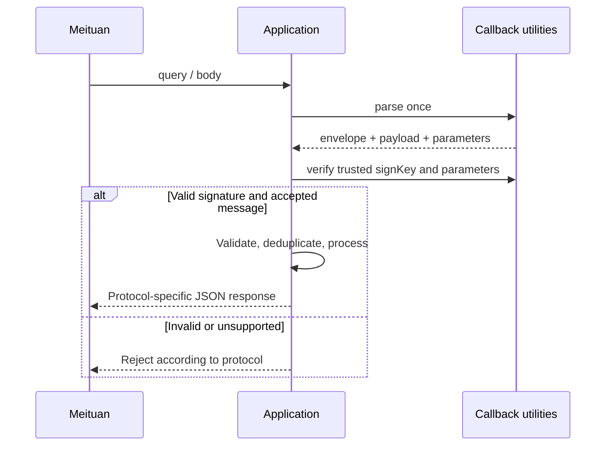

# meituan-sdk-extension

[English](./README.md) | [简体中文](./README.zh-CN.md)

[](https://github.com/easy-4-java/meituan-sdk-extension/actions/workflows/ci.yml) [](#compatibility) [](https://www.apache.org/licenses/LICENSE-2.0.txt)

基于美团官方 `MtOpJavaSDK` 的 Java 扩展库，为服务端应用提供多租户请求执行、业务门面和回调模型。直接复用官方请求对象，核心库可独立于 Spring 使用。

**当前分支** `feature/2.0.x` · **版本** `2.0.x.20260630-SNAPSHOT` · **官方 SDK** `1.0-20261112`

[项目概述](#overview) · [能力与架构](#architecture) · [版本与兼容性](#compatibility) · [安装](#installation) · [快速开始](#quick-start) · [配置与租户存储](#configuration) · [业务调用与平台能力](#api) · [回调解析与响应](#callbacks) · [接口清单](#inventories) · [构建与验证](#verification) · [排查、贡献与许可](#support)

<a id="overview"></a>

## 1. 项目概述

适用于一个应用对接多个开发者账号、授权门店或业务线的场景。调用方传入 `tenantId`，SDK 选择该租户的开发者凭据与授权 token，调用美团并返回官方 `MeituanResponse<T>`。回调入口将公共参数和业务消息解析为 `MeituanCallbackMessage<T>`，提供独立的验签工具及协议响应对象。

```text
业务请求 + tenantId
  → [业务门面 → 租户存储 → 请求执行器 → 官方 client]
  → 美团 OpenAPI → 官方响应 / 调用异常

美团回调（query / body / Servlet request）
  → [CallbackUtil → 业务模型 + 原始参数]
  → 应用验签、幂等与业务处理 → 协议回执
```

核心库负责调用和协议适配。Web 接收地址、配置持久化、token 更新调度、回调幂等和业务事务由接入应用实现。Spring Boot 项目可参考独立的 [meituan-spring-boot-starter](https://github.com/easy-4-java/meituan-spring-boot-starter)，版本及配置项以该仓库为准。

<a id="architecture"></a>

## 2. 能力与架构

| 能力 | 实现与边界 |
|---|---|
| 官方 SDK 请求覆盖 | 15 个业务门面覆盖固定版本中的 1,148 个正式 `@ApiMeta` 请求，官方 `corgiTest` 测试请求不在范围内 |
| 多租户调用 | 内存存储或自定义存储、按开发者凭据缓存 client、按调用选择 token |
| 平台能力 | OAuth 换取与刷新 token、统一授权、单次调用超时、`commonInvokeApi` |
| 回调 | 27 个业务、282 组 `businessId + msgType` 登记，自动或显式模型解析、验签和同步响应 |
| 验证 | SDK 请求覆盖测试、枚举与注册表一致性测试、JUnit 回归、JaCoCo 和严格 Javadoc 检查 |

本项目为单个 Maven JAR，核心包如下。

| Package | 职责 |
|---|---|
| [`config`](src/main/java/io/github/easy4j/meituan/config) | 共享客户端默认值和租户凭据 |
| [`client`](src/main/java/io/github/easy4j/meituan/client) | 官方 client 工厂和请求执行器 |
| [`tenant`](src/main/java/io/github/easy4j/meituan/tenant) | 存储 SPI、加载器、内存与 TTL 缓存、ThreadLocal 上下文 |
| [`service`](src/main/java/io/github/easy4j/meituan/service) | 业务门面与独立的 MeituanPlatformService |
| [`callback`](src/main/java/io/github/easy4j/meituan/callback) | 解析、验签、公共信封、响应与模型索引 |
| [`callback/model`](src/main/java/io/github/easy4j/meituan/callback/model) | 按 `biz<业务ID>` 分包的业务模型 |
| [`callback/type`](src/main/java/io/github/easy4j/meituan/callback/type) | 唯一消息定义源，枚举关联编号、模型与官网文档 |
| [`exception`](src/main/java/io/github/easy4j/meituan/exception) | MeituanJavaException 调用异常 |

<a id="compatibility"></a>

## 3. 版本与兼容性

各分支的源码目标与 CI 工具链分别记录如下。当前分支按 Java 17 编译，CI 使用 JDK 17，请使用相同 JDK 复现构建。

| 分支 | POM 版本 | 编译目标 / CI JDK | JSON / Servlet | Maven Wrapper |
|---|---|---|---|---|
| `feature/1.0.x` | `1.0.x.20260730-SNAPSHOT` | 8 / 8 | Jackson 2.18.9 · `javax.servlet` | 3.9.16 |
| `feature/2.0.x` | `2.0.x.20260630-SNAPSHOT` | 17 / 17 | Jackson 2.22.1 · `jakarta.servlet` | 3.9.16 |
| `feature/3.0.x` | `3.0.x.20260730-SNAPSHOT` | 17 / 21 | Jackson 3.2.4 · `jakarta.servlet` | 4.0.0-rc-5 |

版本依据各分支 `pom.xml` 与 CI 配置。当前 `2.0.x` 使用 Jackson 2 的 `com.fasterxml.jackson.*` API。Servlet API 为 `provided`，Servlet 入口由宿主提供 Jakarta Servlet 6 API。

`2.0.x` 在构建时校验官方 SDK 原包并转换其 Validation 引用为 Jakarta，再内嵌到扩展 JAR。`1.0.x` 和 `3.0.x` 直接依赖官方 SDK，其内部仍包含 `javax.validation` 依赖，选版本时需结合宿主依赖树核对。升级跨版本线时更新 Jackson/Servlet import；旧回调包名也需改为 `callback.model.biz<业务ID>`。


### 3.1 Jakarta Validation 适配

该分支将转换后的官方 SDK 类内嵌到扩展 JAR，使用 Jakarta Validation 3.0.2、Hibernate Validator 8.0.4.Final 及 Expressly 5.0.0。消费方只需引入扩展库，不要再添加原始 `MtOpJavaSDK` 或旧版 javax Validation / Hibernate Validator 6，以免出现重复类和混合校验栈。

构建输入固定为 `com.sankuai.sjst:MtOpJavaSDK:1.0-20261112`，SHA-256 为 `144ed5569a112b1c27de3b9b3d5a237781c593823a73268623832fb28863250c`。构建拒绝不匹配的输入，并在 `META-INF/easy4j/meituan-sdk-origin.properties` 记录来源。仅转换 `javax.validation` 命名空间，保留官方类和签名字节码。

<a id="installation"></a>

## 4. 安装

### 4.1 Maven 依赖

使用与你的 JDK、Jackson 和 Servlet 栈匹配的版本。以下坐标来自当前 [pom.xml](pom.xml)，属于 SNAPSHOT 版本。

```xml
<dependency>
    <groupId>io.github.easy4j</groupId>
    <artifactId>meituan-sdk-extension</artifactId>
    <version>2.0.x.20260630-SNAPSHOT</version>
</dependency>
```

消费当前 SNAPSHOT 及官方 SDK 需要相应仓库读取权限。在应用 POM 中配置仓库，在用户 Maven settings 中配置匹配的 server ID。仓库配置写入已有 `<repositories>`，server 配置合并到已有 settings，凭据通过环境变量注入。

```xml
<repositories>
    <repository>
        <id>2624322-snapshot-3EoOv3</id>
        <url>https://packages.aliyun.com/6927b116e6c3e0425dbdf60d/maven/2624322-snapshot-3eoov3</url>
        <releases><enabled>false</enabled></releases>
        <snapshots><enabled>true</enabled></snapshots>
    </repository>
    <repository>
        <id>2624322-release-6F6h6R</id>
        <url>https://packages.aliyun.com/6927b116e6c3e0425dbdf60d/maven/2624322-release-6f6h6r</url>
        <releases><enabled>true</enabled></releases>
        <snapshots><enabled>false</enabled></snapshots>
    </repository>
</repositories>
```

```xml
<settings>
    <servers>
        <server>
            <id>2624322-snapshot-3EoOv3</id>
            <username>${env.ALIYUN_PACKAGES_USERNAME}</username>
            <password>${env.ALIYUN_PACKAGES_PASSWORD}</password>
        </server>
        <server>
            <id>2624322-release-6F6h6R</id>
            <username>${env.ALIYUN_PACKAGES_USERNAME}</username>
            <password>${env.ALIYUN_PACKAGES_PASSWORD}</password>
        </server>
    </servers>
</settings>
```

### 4.2 从源码安装

在仓库根目录执行。已有仓库权限可直接运行 `./mvnw install`。需要本地安装官方 SDK 时，使用根目录的 [20261112 发行包](sdk_java_20261112.zip) 和对应 [POM](libs/MtOpJavaSDK-1.0-20261112.pom)。

```bash
unzip sdk_java_20261112.zip -d target/official-sdk
./mvnw org.apache.maven.plugins:maven-install-plugin:3.1.4:install-file \
  -Dfile=target/official-sdk/MtOpJavaSDK/MtOpJavaSDK-1.0-SNAPSHOT.jar \
  -Dsources=target/official-sdk/MtOpJavaSDK/MtOpJavaSDK-1.0-SNAPSHOT-sources.jar \
  -DpomFile=libs/MtOpJavaSDK-1.0-20261112.pom
./mvnw -B --no-transfer-progress install
```

解压出的文件名虽为 `1.0-SNAPSHOT`，安装坐标由 POM 指定为 `com.sankuai.sjst:MtOpJavaSDK:1.0-20261112`。`libs/` 中旧日期 JAR 不能替代该发行包。成功后扩展 JAR 位于 `target/`，同时安装到本地 Maven 仓库。首次构建其他依赖仍需要网络。

<a id="quick-start"></a>

## 5. 快速开始

下面是独立核心库的完整初始化与外卖订单查询示例。准备已授权的开发者凭据、token 和真实订单号，通过 `MEITUAN_DEVELOPER_ID`、`MEITUAN_SIGN_KEY`、`MEITUAN_APP_AUTH_TOKEN`、`MEITUAN_ORDER_ID` 注入环境变量，在已引入本库的应用中运行。

```java
import com.meituan.sdk.MeituanResponse;
import com.meituan.sdk.model.waimaiNg.order.orderQueryById.OrderQueryByIdRequest;
import io.github.easy4j.meituan.client.DefaultMeituanRequestExecutor;
import io.github.easy4j.meituan.client.MeituanClientFactory;
import io.github.easy4j.meituan.config.MeituanConfig;
import io.github.easy4j.meituan.config.MeituanTenantConfig;
import io.github.easy4j.meituan.service.MeituanWaimaiService;
import io.github.easy4j.meituan.service.impl.MeituanWaimaiServiceImpl;
import io.github.easy4j.meituan.tenant.InMemoryMeituanTenantConfigStorage;

public class MeituanQuickStart {
    public static void main(String[] args) {
        MeituanConfig config = new MeituanConfig();
        config.setConnectTimeout(5000);
        config.setReadTimeout(10000);
        config.setNeedSslCheck(true);

        MeituanTenantConfig tenant = new MeituanTenantConfig();
        tenant.setDeveloperId(Long.valueOf(System.getenv("MEITUAN_DEVELOPER_ID")));
        tenant.setSignKey(System.getenv("MEITUAN_SIGN_KEY"));
        tenant.setAppAuthToken(System.getenv("MEITUAN_APP_AUTH_TOKEN"));
        tenant.setBusinessId(2);

        InMemoryMeituanTenantConfigStorage storage = new InMemoryMeituanTenantConfigStorage();
        storage.addTenant("tenant-a", tenant);
        MeituanClientFactory factory = new MeituanClientFactory(config);
        DefaultMeituanRequestExecutor executor = new DefaultMeituanRequestExecutor(factory, storage);
        MeituanWaimaiService waimai = new MeituanWaimaiServiceImpl(executor);

        OrderQueryByIdRequest request = new OrderQueryByIdRequest();
        request.setOrderId(Long.valueOf(System.getenv("MEITUAN_ORDER_ID")));
        MeituanResponse<?> response = waimai.orderQueryById(request, "tenant-a");
        System.out.println(response);
    }
}
```

示例会发起真实请求，输出官方响应。订单与 token 必须属于已授权范围。业务方法直接接收官方请求对象，大部分门面保留 `MeituanResponse<?>` 返回签名。需要完整响应泛型时，可用 `executor.execute(request, "tenant-a")`，由请求的 `MeituanRequest<T>` 推导类型。

<a id="configuration"></a>

## 6. 配置与租户存储

### 6.1 共享配置与租户配置

核心库通过 Java 对象配置，未内置 YAML 绑定或 `meituan.*` 配置前缀。以下默认值来自 [MeituanConfig.java](src/main/java/io/github/easy4j/meituan/config/MeituanConfig.java)。

| 配置 | 默认值 | 语义 |
|---|---|---|
| `serverUrl` | `https://api-open-cater.meituan.com` | 官方服务地址 |
| `charset` | `UTF-8` | 请求字符集 |
| `version` | `2` | 协议版本 |
| `connectTimeout` / `readTimeout` | `null` | 毫秒，未设置时沿用官方 builder 默认值 |
| `needSslCheck` | `null` | 未设置时沿用官方 builder 默认值 |

[MeituanTenantConfig](src/main/java/io/github/easy4j/meituan/config/MeituanTenantConfig.java) 保存 `tenantId`、`appId`、`developerId`、`signKey`、`appAuthToken`、`businessId`。工厂要求 `developerId` 非空、`signKey` 非空白；请求业务编号来自官方请求元数据，租户的 `businessId` 不会覆盖它。

### 6.2 可插拔存储与 TTL 缓存

实现 `MeituanTenantConfigStorage.findByTenantId(String)`，返回 `Optional<MeituanTenantConfig>`，即可接入数据库或配置中心。`MeituanTenantConfigLoader.load(String)` 使用相同返回类型。

以下片段复用快速开始中的 `storage`、`factory` 和 `tenant`。将加载器替换为实际存储查询即可缓存远程配置。

```java
import io.github.easy4j.meituan.tenant.CachedMeituanTenantConfigStorage;
import java.time.Duration;

CachedMeituanTenantConfigStorage cached = new CachedMeituanTenantConfigStorage(
        storage::findByTenantId, Duration.ofMinutes(10));
DefaultMeituanRequestExecutor cachedExecutor = new DefaultMeituanRequestExecutor(factory, cached);
cached.put("tenant-a", tenant);
cached.refresh("tenant-a");
cached.evict("tenant-a");
cached.clear();
```

默认 TTL 为 `Duration.ZERO`，表示不自动过期。`put` 立即更新，`refresh` 从加载器重新读取，`evict` 移除单租户，`clear` 清空缓存。缓存只是进程内视图，调用方应先保存新 token，再更新或刷新缓存。内存存储适合静态初始化，运行期并发更新请使用适合该场景的存储实现。

`MeituanTenantContextHolder` 是显式使用的 ThreadLocal 辅助类。业务门面的 `tenantId` 仍需传入，跨线程传播和请求结束时 `clear()` 由应用处理。

<a id="api"></a>

## 7. 业务调用与平台能力

### 7.1 业务门面

| 接口 | 主要范围 |
|---|---|
| [`MeituanCateringService`](src/main/java/io/github/easy4j/meituan/service/MeituanCateringService.java) | 餐饮预订、在线点、排队、品牌会员卡 |
| [`MeituanDaocanService`](src/main/java/io/github/easy4j/meituan/service/MeituanDaocanService.java) | 到店餐饮团购、闪惠等 |
| [`MeituanDdzhkhAuthService`](src/main/java/io/github/easy4j/meituan/service/MeituanDdzhkhAuthService.java) | 业务 59 账号授权、门店映射与相关能力 |
| [`MeituanDeliveryService`](src/main/java/io/github/easy4j/meituan/service/MeituanDeliveryService.java) | 配送及团购配送 |
| [`MeituanDistributionService`](src/main/java/io/github/easy4j/meituan/service/MeituanDistributionService.java) | 站外分销 |
| [`MeituanFreetryService`](src/main/java/io/github/easy4j/meituan/service/MeituanFreetryService.java) | 免费试 |
| [`MeituanKemanmanService`](src/main/java/io/github/easy4j/meituan/service/MeituanKemanmanService.java) | 客满满 |
| [`MeituanKuailvService`](src/main/java/io/github/easy4j/meituan/service/MeituanKuailvService.java) | 快驴 |
| [`MeituanLiveService`](src/main/java/io/github/easy4j/meituan/service/MeituanLiveService.java) | 美团平台直播 |
| [`MeituanPayService`](src/main/java/io/github/easy4j/meituan/service/MeituanPayService.java) | 美团收单 |
| [`MeituanRetailService`](src/main/java/io/github/easy4j/meituan/service/MeituanRetailService.java) | 服务零售 |
| [`MeituanStoreService`](src/main/java/io/github/easy4j/meituan/service/MeituanStoreService.java) | 门店信息、门店直连等 |
| [`MeituanToolsService`](src/main/java/io/github/easy4j/meituan/service/MeituanToolsService.java) | 工具型服务、到店广告等 |
| [`MeituanTravelService`](src/main/java/io/github/easy4j/meituan/service/MeituanTravelService.java) | 酒旅经营宝 |
| [`MeituanWaimaiService`](src/main/java/io/github/easy4j/meituan/service/MeituanWaimaiService.java) | 外卖餐饮 |

方法级参数与路由以接口源码、官网文档为准。`execute(request, tenantId)` 使用该租户的 `appAuthToken`；`executeWithoutAuth(request, tenantId)` 仅选择该租户的开发者凭据。两者仍会签名。无租户的 `executeWithoutAuth(request)` 仅适用于固定 client 构造方式，工厂方式下会报错。自定义执行器应覆盖带 `tenantId` 的无 token 方法，其默认实现会拒绝执行，避免丢失租户隔离。

### 7.2 平台能力

以下片段中的 `authorizationCode` 来自授权流程，`refreshToken` 来自此前保存的 token 响应，其他对象沿用快速开始。

```java
import io.github.easy4j.meituan.service.MeituanPlatformService;

MeituanPlatformService platform = new MeituanPlatformService(factory, storage);
var token = platform.getOAuthToken(2, authorizationCode, "tenant-a");
var renewedToken = platform.refreshToken(2, refreshToken, "tenant-a");
var response = platform.execute(request, "tenant-a", 3000, 8000);
```

`MeituanPlatformService` 还提供 `execute(request, tenantId, realOpBizCode)` 和 `commonInvokeApi(request, responseType, tenantId)`。通用请求的 token、`realOpBizCode` 等字段由调用方按接口要求填写，`tenantId` 负责选择开发者凭据。平台方法为每次调用创建独立 client，避免单次超时修改影响缓存 client。

OAuth 返回结果需由应用持久化并写回租户配置，库没有后台自动刷新任务。官方 `MtSdkException` 会包装为 `MeituanJavaException`，保留 cause；正常返回的业务失败响应仍需调用方按协议判断。

<a id="callbacks"></a>

## 8. 回调解析与响应

### 8.1 解析、验签与业务处理

`CallbackUtil` 提供 Servlet 和 `query + body` 两组入口，每组均支持自动识别或显式 `Class<T>`。自动入口按 `businessId + msgType` 选择模型，部分旧协议支持 `invokeType`。业务载荷位于 `callback.model.biz<业务ID>`。

下面是创建会员 `businessId=59`、`msgType=5910019` 的接入骨架。`signKey` 必须来自应用可信的配置映射，会员创建逻辑由应用补入 `createOrFindMember`，返回官网规定的完整响应字段。

```java
import io.github.easy4j.meituan.callback.CallbackUtil;
import io.github.easy4j.meituan.callback.MeituanCallbackMessage;
import io.github.easy4j.meituan.callback.MeituanCallbackResponse;
import io.github.easy4j.meituan.callback.MeituanCallbackSigner;
import io.github.easy4j.meituan.callback.model.biz59.MemberCreatedMessage;
import io.github.easy4j.meituan.callback.model.biz59.MemberCreatedResult;
import jakarta.servlet.http.HttpServletRequest;

public abstract class MemberCallbackHandler {
    public MeituanCallbackResponse<String> handle(HttpServletRequest request, String signKey) {
        MeituanCallbackMessage<?> callback = CallbackUtil.parse(request);
        if (!MeituanCallbackSigner.verify(signKey, callback.getParameters(), callback.getSign())) {
            return MeituanCallbackResponse.failure(-2, "invalid signature");
        }
        if (!"59".equals(callback.getBusinessId()) || !"5910019".equals(callback.getMsgType())) {
            return MeituanCallbackResponse.failure(-1, "unsupported message");
        }
        MemberCreatedMessage message = (MemberCreatedMessage) callback.getMessage();
        MemberCreatedResult result = createOrFindMember(message);
        return MeituanCallbackResponse.successData(result);
    }

    protected abstract MemberCreatedResult createOrFindMember(MemberCreatedMessage message);
}
```

Web 层将返回对象序列化为 JSON。示例中的 `-1`、`-2` 是应用示例值，实际失败回执须按该消息的官网协议设置；未验签通过前不得产生业务副作用。执行会员创建、核销、退款等动作前，按 `msgId` 和业务约束做持久化幂等，并按约定检查时间窗口。解析方法本身不执行验签、去重或业务字段校验。



### 8.2 输入与原文规则

以下是同一处理器中可选的解析方式，`query` 为原始查询字符串，`body` 为请求体或已解码参数。只选择一种入口读取请求。

```java
MeituanCallbackMessage<?> automatic = CallbackUtil.parse(query, body);
MeituanCallbackMessage<MemberCreatedMessage> typed = CallbackUtil.parse(query, body, MemberCreatedMessage.class);
MeituanCallbackMessage<MemberCreatedMessage> servlet = CallbackUtil.parse(request, MemberCreatedMessage.class);
MeituanCallbackMessage<String> raw = CallbackUtil.parse(query, body, String.class);
```

- `body` 支持表单字符串、JSON 信封字符串、已解码 Map 或信封对象。body 参数覆盖同名 query 参数，同一来源重名参数取最后一个值。
- 标准字段为 `message`，部分旧协议使用 `param`、`params` 或独立表单字段。已解码 Map 不应再次 URL 解码。Servlet 表单入口沿用容器解析，JSON 入口读取 body，应用须协调其他过滤器的请求体消费。
- `getParameters()` 保留用于验签的参数快照，`getRawMessage()` 保留已解码的消息文本。对象形式的 JSON 消息会重新序列化，无法恢复原始 JSON 排版，应按平台实际签名的参数验签。
- 已登记的强类型模型遇到缺失或非法消息时抛出 `IllegalArgumentException`。自动解析遇到未知组合时保留消息文本，无 `message` 或 `param` 时载荷为空。显式 `String.class` 会保留空白格式，但拒绝缺失或纯空白消息。
- Jackson 忽略未知字段，支持模型声明的内嵌 JSON 字符串。该映射不等同于业务必填、范围或权限校验。

### 8.3 响应格式

| 入口 | 输出语义 |
|---|---|
| `success()` | `code=0`、`message=success`、`data=null` |
| `successData(result)` | 业务对象或列表序列化一次，外层 `data` 为 JSON 字符串 |
| `successJson(json)` | 已序列化 JSON 文本作为字符串 `data`，避免再次编码 |
| `of(0, "ok", result)` | 按传入类型直接嵌套 `data`，适用于官网要求对象的回执 |
| `failure(code, message)` | 非 0 错误码；具体取值按消息协议 |
| `withTraceId(traceId)` | 返回带追踪标识的响应副本，空值省略 |
| `flashOrderSuccess()` | 闪惠订单 `310001` 的专用 `{"data":"ok"}` |
| `InventoryQueryResponse` | 服务零售库存查询使用字符串 `code`、`msg` 和字符串 `data` |

`MemberCreatedResult`、`ReservationOrderDecision`、`MerchantCouponIssueResult` 等模型与接口清单关联。会员创建响应的 `expireDate` 是毫秒时间戳，入站消息的同名字段为日期字符串，构造结果时需要转换。

### 8.4 新增回调只维护一处定义

在对应 `MeituanBusiness<业务ID>MessageType` 中添加枚举项，登记消息编号、名称、官网地址及 `messageClass`。`MeituanCallbackModels` 从枚举生成只读索引，`all()` 返回完整定义，`find(businessId, msgType)` 查模型。新业务还需把其枚举加入注册表的业务目录。

`resolve(callback)` 同时检查业务和消息编号，`fromMsgType(msgType)` 仅在当前业务内查询。枚举覆盖的是可入站识别的消息，`model` 下还包含响应对象及嵌套结构，因此文件数不会与枚举数相等。

已核实业务 18 的三个编号 `1810057`、`1810061`、`1810257` 均支持自动解析。业务 59 的 `5910023` 已核实编号，但官网未提供字段定义，暂以 `String` 保留消息原文。其余未核实项在对应接口清单中标明原因。业务 71 的审核结果通知登记为 `7110001`，能力名称为 `poi_openapi_msg_push`；该业务的五个门店直连 API 通过租户选择开发者凭据，不携带 `appAuthToken`。

<a id="inventories"></a>

## 9. 接口清单

[`docs/`](docs/) 按官网一级业务分类保存 19 份接口清单。每份按业务分组，表格包含接口描述、业务 ID、消息编号、示例 `opBizCode`、接口类型、官网地址及适用的模型链接。示例 `opBizCode` 是官网样例值，实际请求应使用自己的业务参数。

| 分类 | 接口清单 |
|---|---|
| 餐饮 | [到店餐饮](docs/到店餐饮-接口清单.md) · [外卖餐饮](docs/外卖餐饮-接口清单.md) · [餐饮系统-智能版](docs/餐饮系统-智能版-接口清单.md) |
| 零售与门店 | [服务零售](docs/服务零售-接口清单.md) · [门店基础信息直连](docs/门店基础信息直连-接口清单.md) |
| 配送与分销 | [配送服务](docs/配送服务-接口清单.md) · [站外分销](docs/站外分销-接口清单.md) · [自动物流车](docs/自动物流车-接口清单.md) |
| 营销与经营 | [免费试](docs/免费试-接口清单.md) · [客满满](docs/客满满-接口清单.md) · [快驴](docs/快驴-接口清单.md) · [美团平台直播](docs/美团平台直播-接口清单.md) · [工具型服务](docs/工具型服务-接口清单.md) |
| 其他业务 | [充电宝](docs/充电宝-接口清单.md) · [企业版](docs/企业版-接口清单.md) · [美团收单](docs/美团收单-接口清单.md) · [美团租车](docs/美团租车-接口清单.md) · [酒旅经营宝](docs/酒旅经营宝-接口清单.md) · [游戏实物履约系统](docs/游戏实物履约系统-接口清单.md) |

清单同时包含 API 与消息文档，部分官网条目仍缺少可核实内容。固定 SDK 请求覆盖由 [MeituanApiCoverageTest](src/test/java/io/github/easy4j/meituan/MeituanApiCoverageTest.java) 检查；回调枚举和模型映射由 [MeituanMessageTypeCoverageTest](src/test/java/io/github/easy4j/meituan/callback/type/MeituanMessageTypeCoverageTest.java) 检查。该覆盖范围随固定 SDK 和已登记消息定义，不代表所有官网未来接口。

<a id="verification"></a>

## 10. 构建与验证

在已准备仓库读取权限或本地官方 SDK 的环境中，使用当前分支的 Wrapper 和 JDK 17 执行与 [CI](.github/workflows/ci.yml) 相同的检查。

```bash
./mvnw -B --no-transfer-progress clean verify javadoc:javadoc javadoc:test-javadoc
```

| 产物 | 路径 |
|---|---|
| 扩展 JAR | `target/meituan-sdk-extension-2.0.x.20260630-SNAPSHOT.jar` |
| 测试结果 | `target/surefire-reports/` |
| JaCoCo HTML / XML / CSV | `target/site/jacoco/` |
| 主源码 Javadoc | `target/reports/apidocs/index.html` |
| 测试源码 Javadoc | `target/reports/testapidocs/index.html` |

JUnit 6 + Mockito 用于本地单元测试。常规构建排除 `integration` 标签，真实 API 调试类位于 `src/test/java/io/github/easy4j/meituan/debug/`，需自行提供授权配置与业务数据。

Javadoc 开启 `doclint=all`、私有成员检查及警告失败。JaCoCo 配置 90% 行覆盖率阈值，但 `haltOnFailure=false`，低于阈值仅警告，构建成功不等于覆盖率达到 90%。CI 上传 `jacoco-coverage`、`surefire-reports` 和 `javadoc-reports`。本地测试或 CI 成功也不等于真实授权、回调或生产联调完成。


[MeituanJakartaValidationTest](src/test/java/io/github/easy4j/meituan/MeituanJakartaValidationTest.java) 验证转换后的请求校验及 SDK 调用；覆盖测试以原始 SDK 为参照。完成 `verify` 并构建消费方 Boot JAR 后，将 `MEITUAN_APPLICATION_JAR` 设置为该应用产物的路径。以下命令验证原始类保留、最小转换、签名字节码和运行时只有一份 SDK。

```bash
python3 tools/verify_jakarta_artifact.py \
  --original-sdk target/official-input/MtOpJavaSDK.jar \
  --sdk-artifact target/meituan-sdk-extension-2.0.x.20260630-SNAPSHOT.jar \
  --application-jar "$MEITUAN_APPLICATION_JAR"
```

该脚本的三个参数均为必填，消费方应用产物由接入项目提供，本仓库的核心构建不会生成 Boot JAR。

<a id="support"></a>

## 11. 排查、贡献与许可

| 现象 | 检查方式 |
|---|---|
| 依赖下载 401 / 找不到 SNAPSHOT | 核对两个仓库地址、大小写一致的 server ID 和读取权限，或从源码安装 |
| `Meituan tenant config not found` | 检查传入 `tenantId` 与存储返回值 |
| `tenantId is required` | 工厂执行器使用带租户的 `executeWithoutAuth` 重载 |
| 回调验签失败 | 检查开发者与可信 signKey 的映射、原始参数、重复解码和 JSON 重排 |
| 解析为 String / 无法自动匹配 | 核对 `businessId + msgType`；旧协议按文档显式传入模型类 |
| 回执 data 类型不符 | 区分 JSON 字符串、嵌套对象以及专用响应协议 |
| Javadoc 失败 | 按警告定位缺失注释、参数标签或非法 HTML，并保留可读 UTF-8 中文 |

提交 Issue 时附版本线、JDK、脱敏请求和最小复现。PR 应保持改动聚焦，更新适用测试及中英文说明，运行上述验证命令。凭据、会员手机号、token 和完整业务数据不应进入公开日志或 Issue。

扩展层采用 [Apache License 2.0](https://www.apache.org/licenses/LICENSE-2.0.txt)。美团官方 `MtOpJavaSDK` 的使用及分发遵循其自身协议。反馈与贡献入口为 [Issues](https://github.com/easy-4-java/meituan-sdk-extension/issues) 和 [Pull requests](https://github.com/easy-4-java/meituan-sdk-extension/pulls)。
